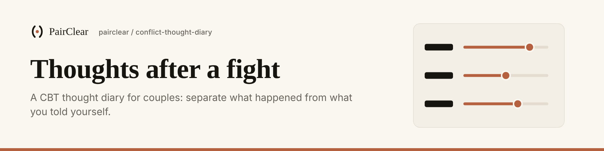
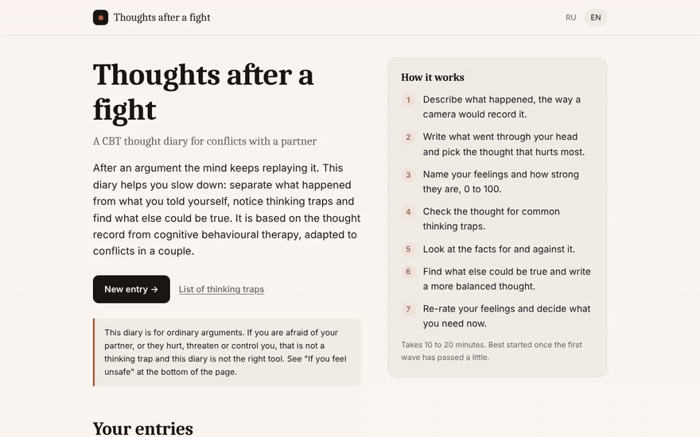
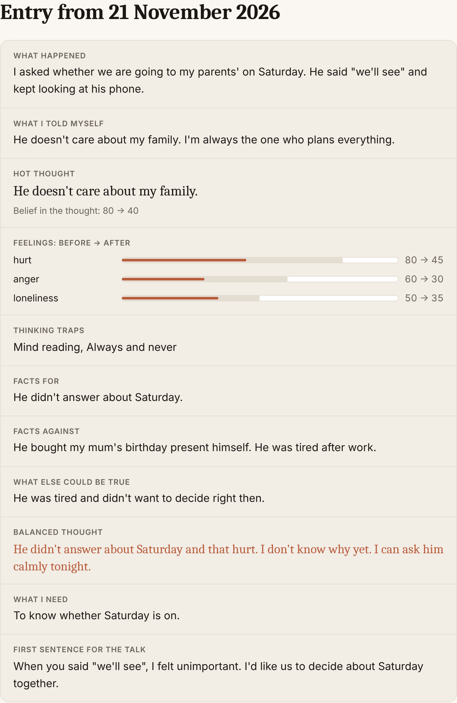

<a href="https://pairclear.github.io/conflict-thought-diary/"><picture>
  <source media="(prefers-color-scheme: dark)" srcset="assets/banner-dark.png">
  
</picture></a>

# Thoughts after a fight: a free CBT thought diary for couples

**[Open the diary →](https://pairclear.github.io/conflict-thought-diary/)** · [Русская версия](README.ru.md) · [ChatGPT prompt](prompts/chatgpt-en.md) · [Claude skill](SKILL.md) · [Thinking traps](thinking-traps.md) · [Printable sheet](templates/thought-record-en.md)

    

> **Self-reflection, not diagnosis or therapy.** This diary does not decide who is right and does not replace a psychologist or couples therapist. **It is for ordinary arguments.** If you are afraid of your partner, or they hurt, threaten or control you, that is not a "thinking trap": call emergency services (112 in Europe, 911 in the US and Canada) or find a free helpline, including for domestic violence, at [findahelpline.com](https://findahelpline.com). The same applies if you are thinking about hurting yourself.

## See it in action

**[Try it in your browser →](https://pairclear.github.io/conflict-thought-diary/?lang=en)** No install, nothing is sent anywhere.

After an argument the mind keeps replaying it. This page walks you through a thought record, the classic worksheet from cognitive behavioural therapy (CBT), adapted to a fight with a partner:

1. **What happened**, the way a camera would record it.
2. **What I told myself**, and the one thought that hurts most (with how much you believe it, 0–100).
3. **Feelings** and their strength, 0–100.
4. **Thinking traps**: mind reading, "always/never", labels, catastrophising and six more, with couple examples.
5. **Facts for and against** the thought.
6. **What else could be true**, and a more balanced thought.
7. **Re-rate** feelings and belief, write what you need now and, if you want, a calm first sentence for the talk.

## What's in the repo

| File | What it is |
|---|---|
| [`index.html`](index.html) | The whole diary: one HTML file, no dependencies, no build step |
| [`prompts/chatgpt-en.md`](prompts/chatgpt-en.md) | A prompt that walks you through one record in ChatGPT, Claude, Gemini or any chat |
| [`prompts/chatgpt-ru.md`](prompts/chatgpt-ru.md) | The same prompt in Russian |
| [`SKILL.md`](SKILL.md) | The diary as a skill for Claude and other agents |
| [`thinking-traps.md`](thinking-traps.md) | Ten common thinking traps with examples from couple conflicts ([RU](thinking-traps.ru.md)) |
| [`templates/`](templates/) | A blank thought record in Markdown to print or copy into Notion/Obsidian ([EN](templates/thought-record-en.md), [RU](templates/thought-record-ru.md)) |

## Quick start

- **In the browser:** open [the diary](https://pairclear.github.io/conflict-thought-diary/). Nothing to install, no account.
- **Offline:** download `index.html` and open it.
- **On paper:** press "Print a blank sheet" on the start page, or print [the template](templates/thought-record-en.md).
- **In a chat:** copy the prompt from [`prompts/chatgpt-en.md`](prompts/chatgpt-en.md) into a new chat.
- **Already filled in an entry?** Press "Prompt for ChatGPT or Claude" on the entry. It copies your record with rules that stop the chat from diagnosing you, labelling your partner or telling you to leave or stay.

## Features

- RU and EN, picked from your browser language (switch any time, or add `?lang=en`)
- All entries in one list; open, edit, print or delete each one
- Feelings before → after shown as bars
- Export: Markdown, CSV for spreadsheets, JSON backup and restore
- A printable one-page blank sheet
- A local safety check: if you type words about violence, threats or self-harm, the page shows where to get help. The check runs in your browser; nothing is sent
- Light and dark theme, works on phones

## Privacy

Entries are stored only in your browser's local storage. The page makes no network requests, has no analytics, cookies or third-party fonts, and never sends what you type anywhere. If someone else uses your device, export your entries and press "Erase everything". It is one readable file: check it yourself.

## Where the method comes from

The thought record is a standard worksheet in cognitive behavioural therapy, which grew out of Aaron Beck's cognitive therapy in the 1960s and 1970s. The idea: how we feel depends not only on an event but on what we tell ourselves about it. Lists of "thinking traps" (also called cognitive distortions) were described by Beck and popularised by David Burns; names and lists differ between authors.

This repo uses its own wording and adapts the record to conflicts with a partner. CBT delivered by trained professionals has a large evidence base, but this particular page has not been studied, so we make no claims about its effect.

**Why the safety rule matters:** questioning your thoughts is useful in ordinary arguments. In a relationship with violence or coercion it can backfire, because fear there is a correct reading of the situation, not a distortion. That is why the diary says so on the start page and shows help when it sees such words.

## FAQ

**Is this a test?** No. It has no scores and does not measure you or your partner.

**Will it tell me who is right?** No. You only describe your side, so it can't. It helps you see your own thoughts more clearly.

**Does it mean my feelings are wrong?** No. The goal is to separate the thought from the facts, not to talk you out of a feeling. A small drop in intensity is a normal result.

**Can my partner fill it in too?** Yes, separately on their own device. Comparing "balanced thoughts" can be a calmer start to a talk than comparing accusations.

**Can I use this with clients?** You can share the link or the files. It is a self-help aid, not an assessment instrument, and it is not validated.

**Why does a relationships site make this?** [PairClear](https://pairclear.com/en/?utm_source=github&utm_medium=readme&utm_campaign=conflict-thought-diary) makes short quizzes about what is happening between two people, also computed in the browser. This diary is a quiet companion to them.

## Contributing

Translations are welcome: add a language object to `T` in `index.html`, a prompt in `prompts/` and a template in `templates/`. Please keep the safety texts, the "not a diagnosis" framing and the rule that the diary never labels the partner.

## More free tools from PairClear

| Repo | What it is |
|---|---|
| [16 associations](https://github.com/pairclear/sixteen-associations) | Write 16 words about one topic and merge them in pairs down to one |
| [Psychology lenses](https://github.com/pairclear/psychology-lenses) | One situation through Freud, Jung, CBT and 5 more schools |
| [Reflection journal](https://github.com/pairclear/reflection-journal) | Questions after a fight, before a hard talk, weekly check-in |
| [Not a therapist](https://github.com/pairclear/not-a-therapist) | Safety rules for AI chats about relationships |
| [Relationship questionnaires](https://github.com/pairclear/relationship-questionnaires) | Seven short open questionnaires, scored in your browser |
| [Couples counselling kit](https://github.com/pairclear/couples-counseling-kit) | Templates, homework and AI prompts for practitioners |

All tools and articles: [pairclear.com](https://pairclear.com/en/?utm_source=github&utm_medium=readme&utm_campaign=conflict-thought-diary) · [github.com/pairclear](https://github.com/pairclear)

## Licence

Code: [MIT](LICENSE). Texts, prompts and templates: [CC BY 4.0](LICENSE-TEXT.md). Texts were written with AI assistance. Examples are invented.
