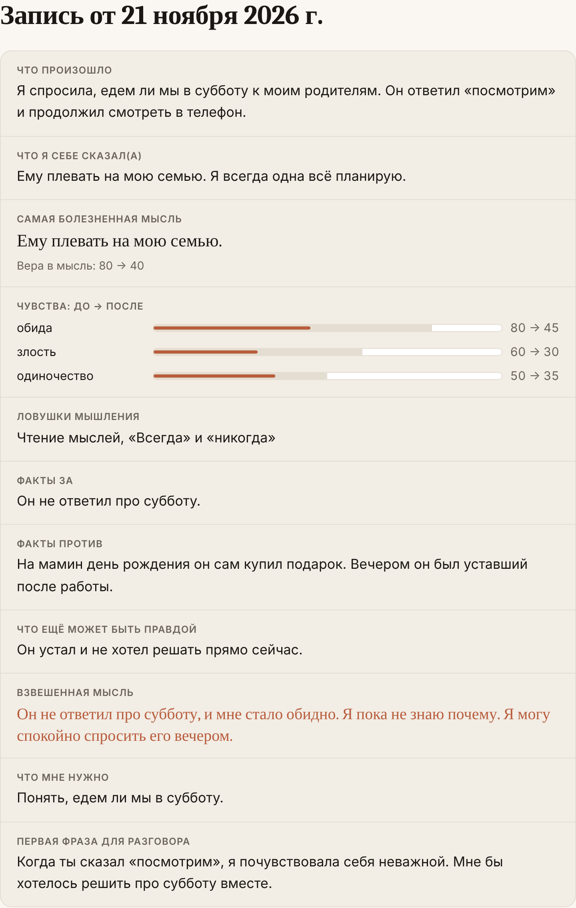

# Мысли после ссоры: бесплатный дневник мыслей (КПТ) для пары

**[Открыть дневник →](https://pairclear.github.io/conflict-thought-diary/?lang=ru)** · [English](README.md) · [Промпт для ChatGPT](prompts/chatgpt-ru.md) · [Скилл для Claude](SKILL.md) · [Ловушки мышления](thinking-traps.ru.md) · [Бланк для печати](templates/thought-record-ru.md)

    

> **Саморефлексия, а не диагностика и не терапия.** Дневник не решает, кто прав, и не заменяет психолога или семейного терапевта. **Он для обычных ссор.** Если ты боишься партнёра, он(а) причиняет боль, угрожает или контролирует тебя, это не «ловушка мышления»: позвони в экстренную службу (112 в Европе и многих странах, 911 в США и Канаде) или найди бесплатную линию помощи, в том числе при домашнем насилии, на [findahelpline.com](https://findahelpline.com). То же, если есть мысли навредить себе.

После ссоры голова снова и снова прокручивает её. Эта страница проводит через дневник мыслей, классический бланк когнитивно-поведенческой терапии (КПТ), адаптированный под ссору с партнёром:

1. **Что произошло**, как записала бы камера.
2. **Что я себе сказал(а)**, и одна мысль, которая задевает сильнее всего (и насколько в неё веришь, 0–100).
3. **Чувства** и их сила, 0–100.
4. **Ловушки мышления**: чтение мыслей, «всегда и никогда», ярлыки, катастрофизация и ещё шесть, с примерами из жизни пары.
5. **Факты за и против** этой мысли.
6. **Что ещё может быть правдой** и более взвешенная мысль.
7. **Новая оценка** чувств и веры в мысль, что мне сейчас нужно и, если хочется, спокойная первая фраза для разговора.

## Что в репозитории

| Файл | Что это |
|---|---|
| [`index.html`](index.html) | Весь дневник: один HTML-файл, без зависимостей и сборки |
| [`prompts/chatgpt-ru.md`](prompts/chatgpt-ru.md) | Промпт, который проводит через одну запись в ChatGPT, Claude, Gemini или любом чате |
| [`prompts/chatgpt-en.md`](prompts/chatgpt-en.md) | Тот же промпт на английском |
| [`SKILL.md`](SKILL.md) | Дневник как скилл для Claude и других агентов |
| [`thinking-traps.ru.md`](thinking-traps.ru.md) | Десять частых ловушек мышления с примерами из ссор в паре ([EN](thinking-traps.md)) |
| [`templates/`](templates/) | Пустой бланк в Markdown: распечатать или скопировать в Notion/Obsidian ([RU](templates/thought-record-ru.md), [EN](templates/thought-record-en.md)) |

## Как начать

- **В браузере:** открой [дневник](https://pairclear.github.io/conflict-thought-diary/?lang=ru). Ничего не надо ставить, регистрации нет.
- **Без интернета:** скачай `index.html` и открой его.
- **На бумаге:** нажми «Распечатать пустой бланк» на стартовой странице или распечатай [шаблон](templates/thought-record-ru.md).
- **В чате:** скопируй промпт из [`prompts/chatgpt-ru.md`](prompts/chatgpt-ru.md) в новый чат.
- **Уже заполнил(а) запись?** Нажми «Промпт для ChatGPT или Claude». Он скопирует запись вместе с правилами: чат не будет ставить тебе диагнозы, навешивать ярлыки на партнёра и советовать уйти или остаться.

## Возможности

- RU и EN, язык берётся из браузера (переключается в любой момент или через `?lang=ru`)
- Все записи в одном списке: открыть, изменить, распечатать, удалить
- Чувства «до → после» в виде шкал
- Экспорт: Markdown, CSV для таблиц, резервная копия JSON и восстановление из неё
- Пустой бланк на одну страницу для печати
- Локальная проверка безопасности: если в тексте есть слова о насилии, угрозах или самоповреждении, страница показывает, куда обратиться. Проверка идёт в браузере, ничего не отправляется
- Светлая и тёмная тема, работает на телефоне

## Приватность

Записи хранятся только в локальном хранилище твоего браузера. Страница не делает сетевых запросов, в ней нет аналитики, cookies и сторонних шрифтов, и она никуда не отправляет то, что ты пишешь. Если устройством пользуется кто-то ещё, выгрузи записи и нажми «Стереть всё». Это один читаемый файл: проверь сам(а).

## Откуда метод

Дневник мыслей — стандартный бланк когнитивно-поведенческой терапии, выросшей из когнитивной терапии Аарона Бека 1960–70-х годов. Идея: наше состояние зависит не только от события, но и от того, что мы себе о нём говорим. Списки «ловушек мышления» (их ещё называют когнитивными искажениями) описывал Бек, а популяризировал Дэвид Бернс; названия и списки у разных авторов отличаются.

Здесь использованы наши собственные формулировки, а бланк адаптирован под конфликты с партнёром. У КПТ, которую проводит обученный специалист, большая доказательная база, но эту конкретную страницу никто не исследовал, поэтому мы не обещаем никакого эффекта.

**Почему важно правило безопасности:** сомневаться в своих мыслях полезно в обычной ссоре. В отношениях с насилием или контролем это может навредить: страх там — верная оценка ситуации, а не искажение. Поэтому дневник говорит об этом на стартовой странице и показывает, куда обратиться, если видит такие слова.

## Вопросы

**Это тест?** Нет. Здесь нет баллов, и дневник не оценивает ни тебя, ни партнёра.

**Он скажет, кто прав?** Нет. Ты описываешь только свою сторону, поэтому он не может. Он помогает яснее увидеть собственные мысли.

**Значит, мои чувства неправильные?** Нет. Цель — отделить мысль от фактов, а не отговорить тебя от чувства. Небольшое снижение силы чувства — нормальный результат.

**Может ли партнёр заполнить его тоже?** Да, отдельно, на своём устройстве. Сравнить «взвешенные мысли» бывает спокойнее, чем сравнивать обвинения.

**Можно использовать с клиентами?** Можно делиться ссылкой или файлами. Это инструмент самопомощи, а не методика оценки, и он не валидирован.

**Зачем это сайту про отношения?** [PairClear](https://pairclear.com/ru/?utm_source=github&utm_medium=readme&utm_campaign=conflict-thought-diary) делает короткие тесты о том, что происходит между двумя людьми, они тоже считаются в браузере. Дневник — тихое дополнение к ним.

## Как помочь

Переводы приветствуются: добавь объект языка в `T` в `index.html`, промпт в `prompts/` и бланк в `templates/`. Пожалуйста, сохрани тексты о безопасности, формулировку «не диагностика» и правило, что дневник не навешивает ярлыков на партнёра.

## Лицензия

Код: [MIT](LICENSE). Тексты, промпты и бланки: [CC BY 4.0](LICENSE-TEXT.md). Тексты написаны с помощью ИИ. Примеры вымышлены.
